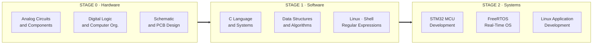

<div align="center">


# Embedded Systems Roadmap

**From Ohm's law to task scheduling, from register bit-fields to system calls.**

<p>
  <a href="https://github.com/Ashleycurry?tab=repositories"></a>
  
  
  
  
</p>

[中文](README.md) | [English](README-English.md)

</div>

---

## What This Is

This is an **index repository**. It does not store the course material itself.

It reorganizes the embedded systems notes scattered across 9 independent repositories into a single executable path: **hardware foundation → software foundation → system development**. Each repository covers exactly one knowledge domain, and can be cloned and studied on its own or followed in sequence along this path.

```text
> power on ...
[BOOT] loading embedded-roadmap v1.0.0
[ OK ] hardware layer   · 3 repositories   · analog / digital / pcb
[ OK ] software layer   · 3 repositories   · c / ds&a / linux
[ OK ] system layer     · 3 repositories   · stm32 / freertos / linux-app
[INFO] recommended entry : analog-circuits-and-components
[INFO] target            : read a datasheet, bring up a chip, ship a firmware
```

## System Overview



## Learning Path

### STAGE 0 · Hardware Foundation

Build intuition for current, logic levels, timing, and real devices first — then see how a chip is designed and how it ends up on a board.

| Repository | Key Topics | Docs |
| :--- | :--- | :---: |
| **[analog-circuits-and-components](https://github.com/Ashleycurry/analog-circuits-and-components)** | `Ohm's Law` `RLC` `Diode` `BJT` `MOSFET` `Pull-up/Down` `Filter` `Multimeter` `Oscilloscope` | `2` |
| **[digital-logic-and-computer-organization](https://github.com/Ashleycurry/digital-logic-and-computer-organization)** | `Logic Gates` `Flip-Flop` `ALU` `Von Neumann` `Instruction Set` `Bus` `Bootloader` | `1` |
| **[schematic-and-pcb-design](https://github.com/Ashleycurry/schematic-and-pcb-design)** | `EasyEDA` `Schematic` `Footprint` `Multi-layer` `DRC` `Soldering` | `2` |

> **Outcome**: read the key parameters of a datasheet, follow a schematic, and explain how an instruction is fetched, decoded, and executed.

### STAGE 1 · Software Foundation

Embedded software is still C programs and operating system interfaces. This layer decides whether your firmware merely runs, or actually holds up.

| Repository | Key Topics | Docs |
| :--- | :--- | :---: |
| **[c-systems-programming-handbook](https://github.com/Ashleycurry/c-systems-programming-handbook)** | `Pointer` `Preprocessor` `Struct` `Dynamic Memory` `File I/O` `Debugging` | `2` |
| **[data-structures-and-algorithms](https://github.com/Ashleycurry/data-structures-and-algorithms)** | `Array` `Linked List` `Stack` `Queue` `Binary Search` `Sorting` `Complexity` | `1` |
| **[linux-shell-regex-notes](https://github.com/Ashleycurry/linux-shell-regex-notes)** | `Ubuntu` `Permission` `Process` `Bash` `awk` `crontab` `Regex` | `3` |

> **Outcome**: write pointer-safe C with controlled memory usage, choose appropriate data structures under tight MCU constraints, and automate builds and log analysis from the shell.

### STAGE 2 · System Development

Apply the two layers above to real silicon and real systems: bare-metal first, then an RTOS, then Linux user space.

| Repository | Key Topics | Docs |
| :--- | :--- | :---: |
| **[stm32-mcu-development-notes](https://github.com/Ashleycurry/stm32-mcu-development-notes)** | `GPIO` `HAL` `NVIC` `USART` `I2C` `Timer` `DMA` `ADC` `SPI` `FSMC` `CAN` `Ethernet` `BLE` `LoRa` `RTC` `Watchdog` | `3` |
| **[freertos-learning-notes](https://github.com/Ashleycurry/freertos-learning-notes)** | `Scheduler` `Task` `Queue` `Semaphore` `Mutex` `Event Group` `Task Notification` `Tickless` `Heap` | `1` |
| **[linux-application-development-notes](https://github.com/Ashleycurry/linux-application-development-notes)** | `GCC` `Makefile` `File I/O` `Process` `Thread` `IPC` `Socket` `Daemon` `epoll` | `1` |

> **Outcome**: configure peripherals and registers independently, refactor bare-metal code into a multi-task system with correct priority and resource handling, and build concurrent network services while diagnosing race conditions.

## Choose a Path by Goal

Not everyone needs the full journey. Pick the main line that matches your goal and treat the rest as supplementary reading.

| Goal | Recommended Path |
| :--- | :--- |
| Bare-metal / RTOS firmware | `digital-logic` → `c-systems` → `data-structures` → `stm32-mcu` → `freertos` |
| Hardware design / board-level engineering | `analog-circuits` → `digital-logic` → `schematic-and-pcb` |
| Embedded Linux / systems software | `linux-shell-regex` → `c-systems` → `data-structures` → `linux-application` |
| Complete understanding from scratch | STAGE 0 → STAGE 1 → STAGE 2 in order |

## Hands-on Projects

Course notes answer "do I know it"; project repositories answer "have I built it". The three repositories below turn the path above into practice, each a complete, buildable, reproducible project:

| Project | Technical Highlights |
| :--- | :--- |
| **[stm32-grayscale-trace-car](https://github.com/Ashleycurry/stm32-grayscale-trace-car)** | STM32F103C8T6 · 8-channel grayscale line following · CD4051 multiplexed sampling · PID closed loop · MG995 servo · L298N drive |
| **[stm32f407-smart-timer-power-controller](https://github.com/Ashleycurry/stm32f407-smart-timer-power-controller)** | STM32F407VE · 4-digit 7-segment display · key and UART dual-channel control · relay switching · thermal protection |
| **[sync-calc-params-motion-control](https://github.com/Ashleycurry/sync-calc-params-motion-control)** | Dual-axis stepper synchronization · proportional velocity scaling · trapezoidal motion profiling |

## Repository Conventions

Every indexed repository follows the same layout, so they can be read and searched as a set:

```text
repository/
├── README.md            Chinese index and content overview
├── README-English.md    English index
└── docs/
    ├── <title>.pdf      Course document (read-only, easy to preview)
    └── <title>.docx     Editable version
```

- The `README` serves as an index and study guide only — **full definitions, diagrams, and examples live in the `docs/` documents**.
- Each document ships in both PDF and DOCX: PDF for online reading, DOCX for annotation and excerpting.
- Every repository ends with a `关键词` (keywords) section listing the technical terms it covers, for easier search.
- Scope follows the source course material; no untested conclusions are stated.

## Tech Stack

<div align="center">

**Embedded**


**Toolchain & System**


**Hardware Design**


</div>

## Links

- **Profile**: [github.com/Ashleycurry](https://github.com/Ashleycurry)
- **Blog**: [xiaogao-code.space](https://xiaogao-code.space)
- **Blog source**: [xiaogao-blog-source](https://github.com/Ashleycurry/xiaogao-blog-source)

## License

[MIT](LICENSE) © 2026 xiaogao-code

---

<div align="center">

<sub>Build close to the machine. Bring intelligence to the edge.</sub>


</div>
