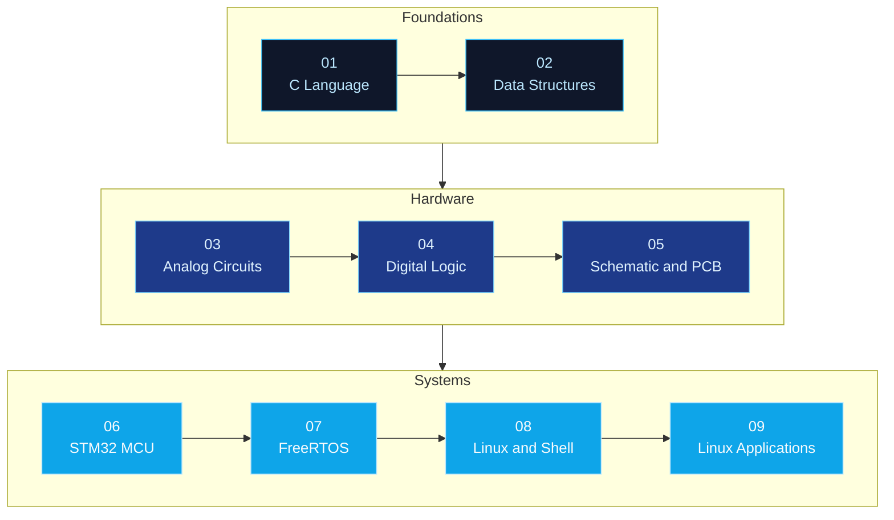

<div align="center">


# Embedded Systems Roadmap

**From Ohm's law to task scheduling, from register bit-fields to system calls.**

<p>
  <a href="https://github.com/Ashleycurry?tab=repositories"></a>
  
  
  
</p>

[中文](README.md) | [English](README-English.md)

<p>
  
  
  
  
  
  
  <br />
  
  
  
  
  
  
  
</p>

</div>

---

## What This Is

This is an **index repository**. It does not store the course material itself.

It strings the embedded systems notes scattered across 9 independent repositories into a single reading path, running from language fundamentals through to system development. Each repository covers exactly one knowledge domain, and can be cloned and studied on its own or followed in numerical order.

```text
> power on ...
[BOOT] loading embedded-roadmap v1.0.0
[ OK ] 01-02  language & algorithms  · c / data structures
[ OK ] 03-05  circuits & hardware    · analog / digital / pcb
[ OK ] 06-09  chips & systems        · stm32 / freertos / linux
[INFO] recommended entry : c-systems-programming-handbook
[INFO] target            : read a datasheet, bring up a chip, ship a firmware
```

## System Overview



## Repository Index

Listed in recommended reading order, from language fundamentals through to system development.

| Repository | Description |
| :--- | :--- |
| `01` [**c-systems-programming-handbook**](https://github.com/Ashleycurry/c-systems-programming-handbook) | C core syntax, pointers, preprocessor, custom types, dynamic memory, and file I/O |
| `02` [**data-structures-and-algorithms**](https://github.com/Ashleycurry/data-structures-and-algorithms) | Arrays, linked lists, stacks, queues, searching and sorting with complexity analysis |
| `03` [**analog-circuits-and-components**](https://github.com/Ashleycurry/analog-circuits-and-components) | Electrical fundamentals, RLC components, diodes, BJTs, MOSFETs, and practical circuits |
| `04` [**digital-logic-and-computer-organization**](https://github.com/Ashleycurry/digital-logic-and-computer-organization) | Logic gates, flip-flops, Von Neumann model, instruction sets, buses, and boot flow |
| `05` [**schematic-and-pcb-design**](https://github.com/Ashleycurry/schematic-and-pcb-design) | EasyEDA schematic capture, PCB layout and routing, footprint design, and soldering |
| `06` [**stm32-mcu-development-notes**](https://github.com/Ashleycurry/stm32-mcu-development-notes) | GPIO, interrupts, timers, DMA, ADC, SPI, CAN, Ethernet, and low-power management |
| `07` [**freertos-learning-notes**](https://github.com/Ashleycurry/freertos-learning-notes) | Task scheduling, kernel porting, queues, semaphores, event groups, and memory management |
| `08` [**linux-shell-regex-notes**](https://github.com/Ashleycurry/linux-shell-regex-notes) | Ubuntu system administration, shell scripting, and regular expression text processing |
| `09` [**linux-application-development-notes**](https://github.com/Ashleycurry/linux-application-development-notes) | GCC toolchain, file I/O, processes and threads, IPC, sockets, and epoll |

## Repository Conventions

Every indexed repository follows the same layout, so they can be read and searched as a set:

```text
repository/
├── README.md            Chinese index and content overview
├── README-English.md    English index
└── docs/
    ├── <title>.pdf      Course document (read-only, easy to preview)
    └── <title>.docx     Editable version
```

- The `README` serves as an index and study guide only — **full definitions, diagrams, and examples live in the `docs/` documents**.
- Each document ships in both PDF and DOCX: PDF for online reading, DOCX for annotation and excerpting.
- Every repository ends with a `关键词` (keywords) section listing the technical terms it covers, for easier search.
- Scope follows the source course material; no untested conclusions are stated.

## Links

- **Profile**: [github.com/Ashleycurry](https://github.com/Ashleycurry)
- **Blog**: [xiaogao-code.space](https://xiaogao-code.space)

## License

[MIT](LICENSE) © 2026 xiaogao-code

---

<div align="center">

<sub>Build close to the machine. Bring intelligence to the edge.</sub>


</div>
