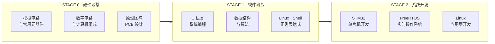

<div align="center">


# 嵌入式学习路线图

**从欧姆定律到任务调度，从寄存器位域到系统调用。**

<p>
  <a href="https://github.com/Ashleycurry?tab=repositories"></a>
  
  
  
  
</p>

[中文](README.md) | [English](README-English.md)

</div>

---

## 这是什么

这是一个**索引仓库**，不存放课程文件本身。

它把分散在 9 个独立仓库中的嵌入式课程笔记，按 **硬件地基 → 软件地基 → 系统开发** 三个阶段重新编排成一条可执行的学习路径。每个仓库只负责一个明确的知识域，可以单独克隆、单独阅读，也可以沿着这条路径顺序推进。

```text
> power on ...
[BOOT] loading embedded-roadmap v1.0.0
[ OK ] hardware layer   · 3 repositories   · analog / digital / pcb
[ OK ] software layer   · 3 repositories   · c / ds&a / linux
[ OK ] system layer     · 3 repositories   · stm32 / freertos / linux-app
[INFO] recommended entry : analog-circuits-and-components
[INFO] target            : read a datasheet, bring up a chip, ship a firmware
```

## 系统总览



## 学习路径

### STAGE 0 · 硬件地基

先建立对电流、电平、时序和器件的直觉，再看懂一颗芯片是如何被设计出来、又是如何被画到板子上的。

| 仓库 | 关键主题 | 文档 |
| :--- | :--- | :---: |
| **[analog-circuits-and-components](https://github.com/Ashleycurry/analog-circuits-and-components)** | `Ohm's Law` `RLC` `Diode` `BJT` `MOSFET` `Pull-up/Down` `Filter` `Multimeter` `Oscilloscope` | `2` |
| **[digital-logic-and-computer-organization](https://github.com/Ashleycurry/digital-logic-and-computer-organization)** | `Logic Gates` `Flip-Flop` `ALU` `Von Neumann` `Instruction Set` `Bus` `Bootloader` | `1` |
| **[schematic-and-pcb-design](https://github.com/Ashleycurry/schematic-and-pcb-design)** | `EasyEDA` `Schematic` `Footprint` `Multi-layer` `DRC` `Soldering` | `2` |

> **阶段产出**：能读懂元器件数据手册的关键参数，能看懂一张原理图，能说清一条指令是怎样从内存取出、译码并执行的。

### STAGE 1 · 软件地基

嵌入式软件的本质仍然是 C 程序和操作系统接口。这一层决定你后面写出来的固件是「能跑」还是「可靠」。

| 仓库 | 关键主题 | 文档 |
| :--- | :--- | :---: |
| **[c-systems-programming-handbook](https://github.com/Ashleycurry/c-systems-programming-handbook)** | `Pointer` `Preprocessor` `Struct` `Dynamic Memory` `File I/O` `Debugging` | `2` |
| **[data-structures-and-algorithms](https://github.com/Ashleycurry/data-structures-and-algorithms)** | `Array` `Linked List` `Stack` `Queue` `Binary Search` `Sorting` `Complexity` | `1` |
| **[linux-shell-regex-notes](https://github.com/Ashleycurry/linux-shell-regex-notes)** | `Ubuntu` `Permission` `Process` `Bash` `awk` `crontab` `Regex` | `3` |

> **阶段产出**：能写出指针安全、内存可控的 C 代码；能在资源受限的 MCU 上自行选择合适的数据结构；能用 Shell 完成构建、日志分析和自动化。

### STAGE 2 · 系统开发

把前两层的能力落到真实芯片与真实系统上：先裸机，再上 RTOS，最后进入 Linux 用户态。

| 仓库 | 关键主题 | 文档 |
| :--- | :--- | :---: |
| **[stm32-mcu-development-notes](https://github.com/Ashleycurry/stm32-mcu-development-notes)** | `GPIO` `HAL` `NVIC` `USART` `I2C` `Timer` `DMA` `ADC` `SPI` `FSMC` `CAN` `Ethernet` `BLE` `LoRa` `RTC` `Watchdog` | `3` |
| **[freertos-learning-notes](https://github.com/Ashleycurry/freertos-learning-notes)** | `Scheduler` `Task` `Queue` `Semaphore` `Mutex` `Event Group` `Task Notification` `Tickless` `Heap` | `1` |
| **[linux-application-development-notes](https://github.com/Ashleycurry/linux-application-development-notes)** | `GCC` `Makefile` `File I/O` `Process` `Thread` `IPC` `Socket` `Daemon` `epoll` | `1` |

> **阶段产出**：能独立完成外设驱动与寄存器配置；能把裸机程序重构为多任务系统并处理优先级与资源竞争；能写多线程网络服务并定位并发问题。

## 按目标选择路径

不是每个人都需要走完全程。按你现在的目标挑一条主线，其余作为补充阅读。

| 目标方向 | 推荐路径 |
| :--- | :--- |
| 裸机固件 / RTOS 固件 | `digital-logic` → `c-systems` → `data-structures` → `stm32-mcu` → `freertos` |
| 硬件设计 / 板级工程 | `analog-circuits` → `digital-logic` → `schematic-and-pcb` |
| 嵌入式 Linux / 系统软件 | `linux-shell-regex` → `c-systems` → `data-structures` → `linux-application` |
| 从零建立完整认知 | STAGE 0 → STAGE 1 → STAGE 2 顺序推进 |

## 配套工程实践

课程笔记解决「知道」，工程仓库解决「做过」。以下三个仓库是上面路径的落地实践，均为可编译、可复现的完整工程：

| 工程 | 技术要点 |
| :--- | :--- |
| **[stm32-grayscale-trace-car](https://github.com/Ashleycurry/stm32-grayscale-trace-car)** | STM32F103C8T6 · 八路灰度循迹 · CD4051 多路采样 · PID 闭环 · MG995 舵机 · L298N 驱动 |
| **[stm32f407-smart-timer-power-controller](https://github.com/Ashleycurry/stm32f407-smart-timer-power-controller)** | STM32F407VE · 四位数码管 · 按键与串口双通道控制 · 继电器通断 · 过温保护 |
| **[sync-calc-params-motion-control](https://github.com/Ashleycurry/sync-calc-params-motion-control)** | 双轴步进同步 · 比例速度缩放 · 梯形加减速规划 |

## 仓库约定

所有被索引的仓库遵循同一套结构，便于批量阅读与检索：

```text
repository/
├── README.md            中文索引与内容概览
├── README-English.md    English index
└── docs/
    ├── <title>.pdf      课程文档（只读，便于在线预览）
    └── <title>.docx     可编辑版本
```

- `README` 只做索引与学习建议，**完整定义、图示与示例以 `docs/` 中的文档为准**。
- 文档同时提供 PDF 与 DOCX 两种格式：PDF 用于在线阅读，DOCX 用于做批注和摘录。
- 每个仓库末尾附有 `关键词` 段落，列出该仓库覆盖的技术术语，便于搜索。
- 内容范围以课程资料为准，不额外宣讲未经实测的结论。

## 技术栈

<div align="center">

**Embedded**


**Toolchain & System**


**Hardware Design**


</div>

## 相关链接

- **个人主页**：[github.com/Ashleycurry](https://github.com/Ashleycurry)
- **技术博客**：[xiaogao-code.space](https://xiaogao-code.space)
- **博客源码**：[xiaogao-blog-source](https://github.com/Ashleycurry/xiaogao-blog-source)

## License

[MIT](LICENSE) © 2026 xiaogao-code

---

<div align="center">

<sub>Build close to the machine. Bring intelligence to the edge.</sub>


</div>
