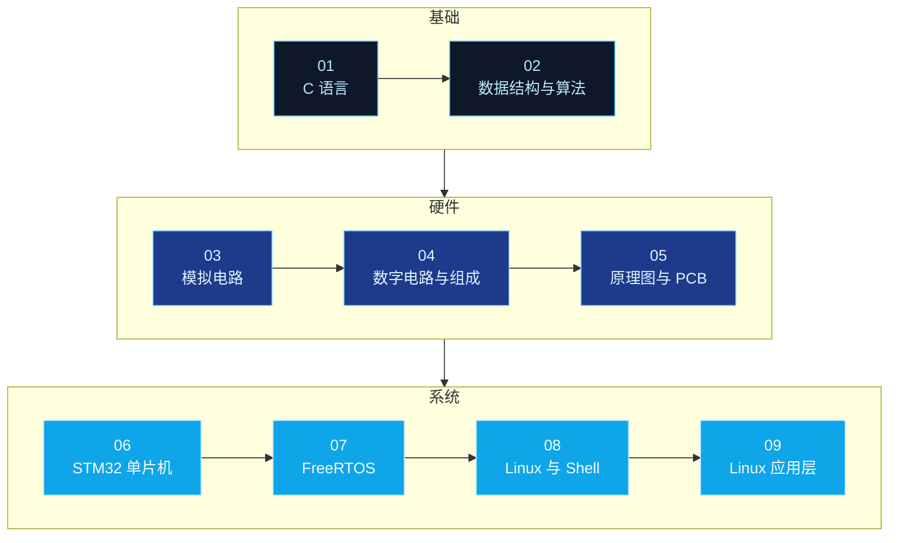

<div align="center">


# 嵌入式学习路线图

**从欧姆定律到任务调度，从寄存器位域到系统调用。**

<p>
  <a href="https://github.com/Ashleycurry?tab=repositories"></a>
  
  
  
</p>

[中文](README.md) | [English](README-English.md)

<p>
  
  
  
  
  
  
  <br />
  
  
  
  
  
  
  
</p>

</div>

---

## 这是什么

这是一个**索引仓库**，不存放课程文件本身。

它把分散在 9 个独立仓库中的嵌入式课程笔记，按一条从语言基础到系统开发的主线串联起来，形成一条可执行的阅读路径。每个仓库只负责一个明确的知识域，可以单独克隆、单独阅读，也可以按编号顺序推进。

```text
> power on ...
[BOOT] loading embedded-roadmap v1.0.0
[ OK ] 01-02  language & algorithms  · c / data structures
[ OK ] 03-05  circuits & hardware    · analog / digital / pcb
[ OK ] 06-09  chips & systems        · stm32 / freertos / linux
[INFO] recommended entry : c-systems-programming-handbook
[INFO] target            : read a datasheet, bring up a chip, ship a firmware
```

## 系统总览



## 仓库索引

按推荐阅读顺序排列，从语言基础一路走到系统开发。

| 仓库 | 简介 |
| :--- | :--- |
| `01` [**c-systems-programming-handbook**](https://github.com/Ashleycurry/c-systems-programming-handbook) | C 语言核心语法、指针、预处理器、自定义类型、动态内存与文件操作 |
| `02` [**data-structures-and-algorithms**](https://github.com/Ashleycurry/data-structures-and-algorithms) | 数组、链表、栈、队列，以及查找、排序算法与复杂度分析 |
| `03` [**analog-circuits-and-components**](https://github.com/Ashleycurry/analog-circuits-and-components) | 电学基础、电阻电容电感、二极管 / 三极管 / MOS 管与典型电路实践 |
| `04` [**digital-logic-and-computer-organization**](https://github.com/Ashleycurry/digital-logic-and-computer-organization) | 逻辑门、触发器、冯诺依曼模型、指令集、总线与引导流程 |
| `05` [**schematic-and-pcb-design**](https://github.com/Ashleycurry/schematic-and-pcb-design) | 嘉立创 EDA 原理图绘制、PCB 布局布线、封装设计与焊接技能 |
| `06` [**stm32-mcu-development-notes**](https://github.com/Ashleycurry/stm32-mcu-development-notes) | GPIO、中断、定时器、DMA、ADC、SPI、CAN、以太网与低功耗管理 |
| `07` [**freertos-learning-notes**](https://github.com/Ashleycurry/freertos-learning-notes) | 任务调度、内核移植、队列、信号量、事件组、任务通知与内存管理 |
| `08` [**linux-shell-regex-notes**](https://github.com/Ashleycurry/linux-shell-regex-notes) | Ubuntu 系统管理、Shell 脚本编程与正则表达式文本处理 |
| `09` [**linux-application-development-notes**](https://github.com/Ashleycurry/linux-application-development-notes) | GCC 工具链、文件 I/O、进程线程、进程间通信、Socket 与 epoll |

## 仓库约定

所有被索引的仓库遵循同一套结构，便于批量阅读与检索：

```text
repository/
├── README.md            中文索引与内容概览
├── README-English.md    English index
└── docs/
    ├── <title>.pdf      课程文档（只读，便于在线预览）
    └── <title>.docx     可编辑版本
```

- `README` 只做索引与学习建议，**完整定义、图示与示例以 `docs/` 中的文档为准**。
- 文档同时提供 PDF 与 DOCX 两种格式：PDF 用于在线阅读，DOCX 用于做批注和摘录。
- 每个仓库末尾附有 `关键词` 段落，列出该仓库覆盖的技术术语，便于搜索。
- 内容范围以课程资料为准，不额外宣讲未经实测的结论。

## 相关链接

- **个人主页**：[github.com/Ashleycurry](https://github.com/Ashleycurry)
- **技术博客**：[xiaogao-code.space](https://xiaogao-code.space)

## License

[MIT](LICENSE) © 2026 xiaogao-code

---

<div align="center">

<sub>Build close to the machine. Bring intelligence to the edge.</sub>


</div>
